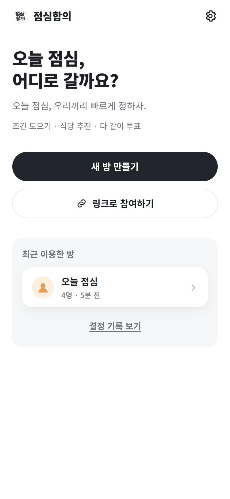
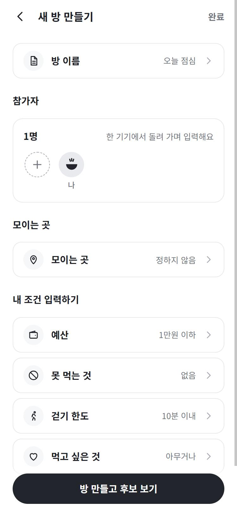
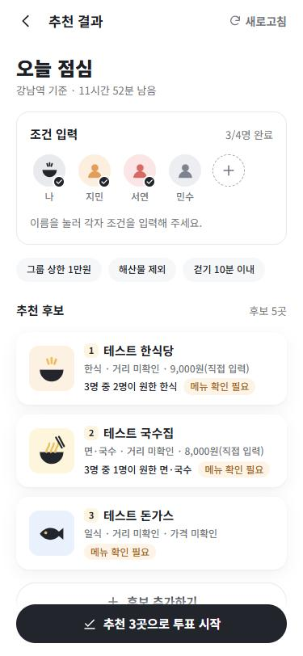
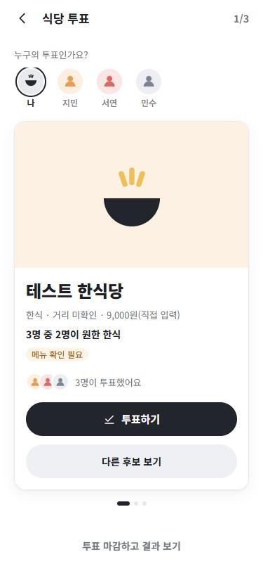
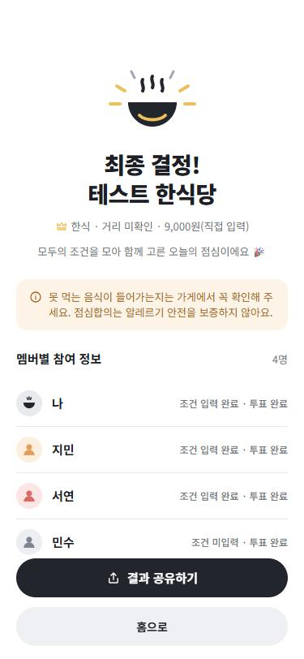
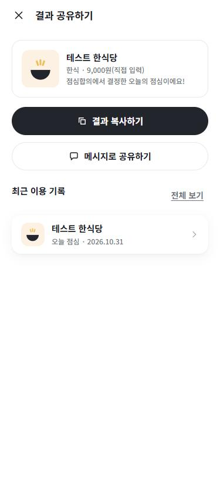
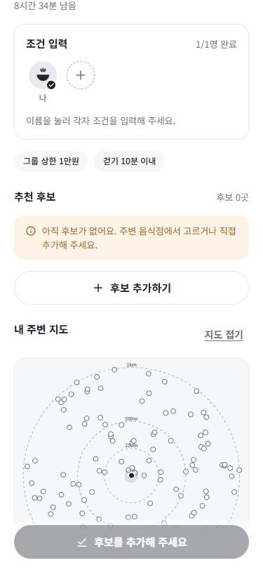
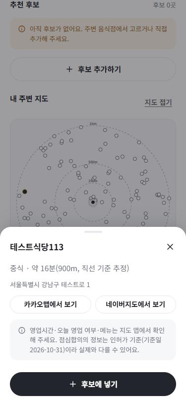

# 점심합의 - 같이 정하는 오늘 점심


**오늘 점심, 우리끼리 빠르게 정하자.**
조건 모으기 · 식당 추천 · 다 같이 투표 — LUNCH AGREEMENT

방장이 방을 만들어 링크를 돌리면 동료들이 가입 없이 예산·못 먹는 것·걷기 한도를 넣고, 앱이 조건을 통과한 후보를 좁혀 투표로 끝내는 **토스 미니앱(앱인토스 WebView)**. 기획 원문: [docs/SUPER_PROMPT.md](docs/SUPER_PROMPT.md)

> **현재 상태 (2026-11-02)**
> - **실데이터 배포 완료**: 전국 영업 중 음식점 **648,519곳**(기준일 2026-10-31)이 격자 타일 46,921개로 GitHub Pages에 올라가 있다. 좌표계 EPSG:5174 실측 확정(표본 226, 중앙값 53m vs 2097 261m), Phase 0 게이트 통과(측정 지점 중앙값 2,502곳, 태그 81.7%).
> - **내 현재 위치 기준**으로 반경 1km 음식점 중 **그룹 조건에 맞는 곳을 앱이 추천**하고, 한 번에 후보로 넣어 투표까지 끝낸다. 지도는 가까운 100곳만 그리고 같은 건물 가게는 묶어서 고른다.
> - 가게를 누르면 **카카오맵·네이버지도에서 보기**로 실제 영업시간·오늘 영업 여부를 확인(그쪽 데이터는 저장하지 않음).
> - 위치와 거기서 계산한 값(거리·도보 분)은 기기 안에서만 쓰고 서버로 보내지 않는다 → 위치기반서비스사업 **비신고 요건** 충족. 공유 방에는 식당의 공개 좌표만 남는다.
> - **랜덤 뽑기**: 방 없이 내 조건에 맞는 주변 음식점 하나를 바로 뽑는다(가격 데이터가 없어 예산으로는 못 거른다).
> - **공유 방 서버 연결**: Supabase 실프로젝트(무료·서울)에서 RLS 테스트와 2인 RPC E2E 통과. 두 실기기 링크 참여는 미확인.
> - **토스 출시됨**: 20261102-2가 2026-11-02 13:16 출시(콘솔 '현재 출시됨'). 앱 로고 반려 후 재검토 통과(D-053). 사용자가 토스앱 테스트를 마쳤다고 보고(항목별 결과는 미기록).
> - **핵심 지표 등록**: 활성 '7일 이후 재방문 유저', 대표 전환 '유저 식별키 발급받은 유저'(임시). 결정 이벤트 코드는 다음 번들에 포함, 업로드 전(D-054).

## 화면

온보딩 가이드([docs/design/onboarding-guide.png](docs/design/onboarding-guide.png))의 01~06 레이아웃·스타일(흰 바탕 · 남색 필 버튼 · 외곽선 필 · 연회색 패널 · 아이콘 노란 포인트)을 그대로 구현했다. 시안의 별점·가격·음식 사진은 없는 데이터라 "종류 · 약 N분(추정) · 가격 미확인/직접 입력"과 자체 음식 종류 그림으로 바꿨다(D-015).

| 01 방 만들기 | 02 참가자 & 조건 | 03 식당 후보 추천 |
|---|---|---|
|  |  |  |
| **04 투표하기** | **05 결과 확인** | **06 공유 & 기록** |
|  |  |  |

| **내 주변 지도** | **가게 상세(지도 앱 연결)** | |
|  |  | |

(캡처의 '테스트○○' 가게는 브라우저 확인용 합성 데이터다.)

## 상태표
`구현` = 코드 있음 · `자동 테스트 통과` · `브라우저 확인` = 개발 서버 375/360px · `샌드박스 확인` · `토스앱 확인`

| 영역 | 상태 | 비고 |
|---|---|---|
| 모노레포 구조(app · data-build · packages/room-core), CI | 구현 | `.github/workflows/ci.yml` — test·typecheck·test:sql·build |
| 앱 아이콘·로고·파비콘·OG·콘솔 로고(사용자 아이콘 원본에서 생성) | 구현 | `npm run icons`, D-017 |
| 도메인 엔진(그룹 조건·하드 필터·못 먹는 것 판정·점수·이유 문장·투표·주변 추천·지도 핀 선별) | 자동 테스트 통과 | app 24개, 가짜 후보 생성 없음 테스트 포함 |
| room-core(토큰·해시·짧은 코드·만료·닉네임·상태 전이·투표 집계·링크) | 자동 테스트 통과 | 13개 |
| Supabase 마이그레이션·RPC·RLS | 실프로젝트 확인 | PGlite + 실서버 `rls_test.sql`·2인 RPC E2E(D-052), pg_cron 등록 |
| data-build(API 전국 수집기·격자 타일·좌표 변환 2종·좌표계 판정·종류 태그·게이트) | 자동 테스트 통과 | 18개. 필드명은 공식 Swagger로 확인(D-032), 타일 계산은 앱과 공용(D-040) |
| 내 위치(권한 창 → Device.getLocation / geolocation) · 반경 1km 주변 음식점 · 거부 시 대체 | 브라우저 확인(토스 경로 D-050은 구현만) | 위치 흉내 + **실데이터 타일**(강남 2,532곳: 타일 25개·gzip 137KB·데스크톱 336ms). **토스앱·실기기 속도 미확인** |
| 내 주변 추천(그룹 조건 필터·종류 분산·다른 곳 보기·바로 넣기) | 브라우저 확인 | D-048. 실데이터로 추천 → 투표 → 결과 확인 |
| 내 주변 지도(자체 SVG, 링·핀·방 후보 강조·추천 순위, 가까운 100곳·같은 건물 묶음) | 브라우저 확인 | D-049. 배경지도(브이월드)는 키 없음 — 미확인(D-038) |
| 카카오맵·네이버지도 장소 검색 링크(영업시간 확인용) | 브라우저 확인 · 정책 문서 확인 | 서비스 오픈 정책 '단순 정보 확인을 위한 타사 웹사이트 이동' 허용 사례(D-042). Device.openURL 토스앱 미확인 |
| Phase 0 음식점 수집 · 좌표계 판정(5174 vs 2097) · 게이트(중앙값 ≥100, 태그 ≥70%) · Pages 배포 | 확인 | Data Build #4(2026-10-31). 주간 실행 #5는 API 응답 지연으로 실패, 이전 데이터 유지 → 수정본(D-047)은 다음 실행에서 확인 |
| 홈 · 방 만들기 · 조건 입력(바텀시트) · 모이는 곳 이름 | 브라우저 확인 | 한 기기 모드 |
| 추천 결과 · 내 주변/직접 후보 추가 · 다른 후보 보기 · 후보 부족 안내 | 브라우저 확인 | 실데이터 |
| 투표(한 기기 모드 돌려 입력) · 결과 · 동률 처리 · 공유 · 기록 · 설정 | 브라우저 확인 | 동률 화면은 코드·단위 테스트만 |
| 360px 가로 스크롤 없음 | 브라우저 확인 | 7개 화면 |
| 공유 방(remote 모드: 링크·코드 참여, 5초 폴링) | 브라우저 확인(1인) · RPC E2E(2인) | 앱 UI로 방 만들기·후보·투표. 두 기기·토스 링크 미확인 |
| 랜덤 뽑기(`/pick`, 방 안 버튼) | 브라우저 확인 | 실데이터·위치 흉내, D-051. 토스앱 미확인 |
| 토스 SDK(공유 링크·클립보드·익명 키·진입 링크) | 구현 | 3.9.0 타입 확인, **토스앱 미확인** |
| `.ait` 빌드 | 확인 | `npm run build:ait` → `app/jeomsimhabui.ait` (Mac에서도 확인, 2026-11-02) |
| 인앱 광고(Phase 4) · 가격 힌트(Phase 5) · 실시간 장소 검색(Phase 6) | ❌ 미착수 | 광고 자리만(`ADS_ENABLED=false`) |

## 구조

```
lunchagree/
├─ app/                      토스 미니앱 (Vite + React + TS + @apps-in-toss/web-framework 3.9.0)
│  ├─ apps-in-toss.config.ts appName 'jeomsimhabui'
│  └─ src/ domain · data · features · platform · storage · ads · routes · components · styles
├─ packages/room-core/       방·토큰·참여·만료·투표 공통(순수 TS) + supabase/migrations · tests
├─ data-build/               공공데이터 → 전국 격자 타일(GitHub Pages)
├─ scripts/                  build-app-icons.py · generate-oss-licenses.mjs
├─ assets/brand/             아이콘 원본·콘솔 로고
└─ docs/                     DECISIONS · ARCHITECTURE · DATA_SOURCES · PLACE_DATA_POLICY · CONSENSUS_ALGORITHM ·
                             TOSS_COMPLIANCE · PRIVACY · SECURITY · LICENSES · TESTING · design/ · screenshots/
```
자세한 그림: [docs/ARCHITECTURE.md](docs/ARCHITECTURE.md)

## 실행
요구: Node.js 24+ (아이콘 재생성은 Python + Pillow). Windows·Mac 모두 동작 확인
```bash
npm install
```
```bash
npm run dev
```
```bash
npm test && npm run typecheck && npm run test:sql && npm run build
```
데이터(Phase 0):
```bash
npm run data:fetch -- --probe
```
```bash
npm run data:fetch -- --open-code <영업상태코드> --focus
```
```bash
npm run data:crs && npm run data:build
```
```bash
npm run build:ait
```

환경변수(`app/.env`, 예시 `app/.env.example`): `VITE_SUPABASE_URL`·`VITE_SUPABASE_ANON_KEY`(없으면 한 기기 모드), `VITE_PLACES_BASE_URL`(음식점 타일 주소, 없으면 후보 직접 추가만), `VITE_VWORLD_KEY`(선택, 지도 배경).

## 다른 프로젝트에서 가져온 것
| 가져온 것 | 출처 |
|---|---|
| 토스 SDK 연동 구조(감싸기·토스 밖 대체 동작) · 저장소 어댑터 · 해시 라우팅 · 진입 링크 · 아이콘/라이선스 스크립트 · 문서 형식 | 사잇(`saeit`) — 역 데이터 등 기능은 가져오지 않음 |
| Supabase RLS · security definer RPC · fail-closed 설정 · SQL 테스트 형식 | 컷픽(`Cutpick/supabase`) |
| 예약 실행 GitHub Actions(cron + 수동, 정각 회피, concurrency) | 기묘한 기록(`StrangeRecords/.github`) |

## 사용자가 직접 할 일
1. 토스앱 항목별 확인 결과 공유(`docs/TESTING.md`) → 상태표 `토스앱 확인` 기록
2. 이벤트 번들 출시 다음 날 대표 전환을 `lunch_decided`로 교체(D-054)
3. (권장) 법률 검토: 위치기반서비스 비신고 요건(D-041)·개인정보 처리방침
4. '점심합의'·'LUNCH AGREEMENT' KIPRIS 확인, 로고 결합형 상표 출원 여부 결정
5. (선택) 브이월드 오픈API 키 발급 + 서비스 URL 등록 → `VITE_VWORLD_KEY`(지도 배경)

## 다음 할 일
- 두 기기 참여·투표 E2E(QR `intoss-private://`), 폴링 확인
- 토스앱에서 위치 권한·타일 로딩 시간(1.8초 제한)·뒤로가기·공유 링크·initialURL 진입·지도 앱 링크 확인
- 다음 주간 Data Build에서 이어받기 동작 확인(D-047)
- 사잇과 `room-core` 공유 순서 확정(현재 점심합의에서 먼저 만듦 — D-029)

---

## Work Log

### 2026-10-31 — 프로젝트 구조·아키텍처·MVP 화면 1차
- **구조**: npm workspaces 모노레포(`app` · `data-build` · `packages/room-core`), 사잇과 같은 스택(Vite 8 · React 19 · TS 7 · SDK 3.9.0). `CLAUDE.md` 작업 규칙, docs 11종(결정 30건 D-001~D-030).
- **브랜드**: 사용자 제공 아이콘(`assets/brand/icon-source.png`)에서 콘솔 로고 600px(흰 배경·둥글림 없음)·앱 로고·워드마크·파비콘·OG 이미지 생성. 원본의 넓은 그림자 때문에 floodfill 대신 회색 테두리 선 스캔으로 경계 검출(D-017).
- **디자인**: 온보딩 가이드 01~06 레이아웃을 그대로 구현 — 디자인 토큰(`design-tokens.css`), 자체 아이콘·아바타·음식 종류 그림. 시안의 별점·가격·사진·이동 정보·카카오톡 버튼은 데이터·정책상 대체(D-014~D-016).
- **도메인 엔진**: 그룹 조건(예산·걷기 최솟값, 못 먹는 것 합집합, 좋아요 정규화) → 하드 필터(자동 완화 없음, 막힌 이유 그룹 수준) → 점수(0.7 좋아요 + 0.3 거리, 비노출) → 이유 문장 → 투표(동률 자동 결정 없음).
- **공유 방**: `room-core`(128bit 토큰·SHA-256·6자리 코드·만료 23:59 KST/12h) + Supabase 스키마(RLS 정책 0개, security definer RPC만, 개인 조건 비노출 그룹 요약). PGlite로 마이그레이션·RLS 테스트 실제 실행 — 일부러 깨뜨리면 실패하는 것까지 확인.
- **두 모드**: Supabase 키가 없으면 '한 기기 모드'(방장 폰으로 참가자 추가·돌려 입력, 서버 전송 없음)로 전체 흐름 동작.
- **data-build**: CSV 파서 · 영업 필터 · EPSG:5174→WGS84(proj4) · 업태/이름 기반 종류 태그 · 역별 1km 샤드 · 필수 컬럼·Phase 0 게이트 검증 · 주간 Actions → Pages(실패 시 이전 산출물 유지). 원본 컬럼명은 미확인이라 한 파일(`column-map.ts`)에 모으고 없으면 빌드 실패.
- **검증**: 자동 테스트 32개(room-core 13 · data-build 8 · app 11) + SQL/RLS 테스트, 타입 검사, 빌드(오픈소스 13개 MIT·ISC·Apache-2.0), `.ait` 빌드. 브라우저(375·360px)에서 전체 흐름·가로 스크롤·콘솔 오류 0 확인. 확인 중 발견한 하단 고정 버튼 사라짐(`overflow-x: hidden`이 sticky를 깸)을 `clip`으로 수정.
- **미확인**: Supabase 실프로젝트, 토스앱(샌드박스·QR), 공공데이터 실데이터, 역 좌표, EPSG 변환 실주소 오차.

### 2026-10-31 — Phase 0: 데이터 출처 확정 · 역 좌표 확보
- **음식점 원본 경로 변경**: 기획서의 파일 15045016은 다운로드 링크(LOCALDATA)가 2026-04-16 서비스 종료로 403. 통합된 **공식 API 15154916**(`apis.data.go.kr/1741000/general_restaurants/info`, 일간 갱신)을 찾아 Swagger로 응답 필드 39개를 확인하고, 이전 코드의 추정 한글 컬럼명을 실제 필드명(`BPLC_NM`·`SALS_STTS_CD`·`CRD_INFO_X/Y`·`BZSTAT_SE_NM` 등)으로 교체. 전화번호·종사자 수 등은 저장하지 않음(D-031·D-032).
- **좌표계 모순 발견**: 포털 설명이 "보정계수 안 들어간 … EPSG:5174"라고 적었지만 5174는 보정이 들어간 정의(미보정은 2097). 차이 약 250m라 두 정의를 모두 두고, 역 안 매장 ↔ 역 좌표 거리로 판정하는 `verify-crs.ts` 작성(D-033).
- **역 좌표 확보**: 국가철도공단 도시광역철도 역사정보(철도데이터포털, 2026-06-30, 1,099행)를 받아 사잇 581역 중 **578역** 매칭(양평 5호선/경의중앙선은 괄호 노선 힌트로 분리). 의존성 없는 XLSX 리더 작성. 역사 주소에서 수집 지역 **65개 시·군·구** 산출, 표기 차이(`서울시`·`충남`·오타·옛 구 이름) 보정(D-034·D-035).
- **수집기**: `fetch-api.ts`(`--probe` 탐색 / `--open-code` 전체 / `--focus` 측정 지역만, 지역 단위 이어받기, 한도 오류 시 중단), `fetch-file.ts`(사잇 파일데이터 수집기 이식). 빌드는 NDJSON 수집본 기준으로 변경, CSV 경로 삭제. data-build.yml은 키·영업 코드가 있을 때만 실행(D-036).
- **검증**: data-build 테스트 16개(좌표계 판정·동명이역·지역 보정·API 응답 파싱·필드 최소화 포함), 타입 검사 통과. 키 없이 실행하면 수집·빌드가 안내 문구와 함께 멈추는 것 확인.
- **막힌 것**: 음식점 수집·좌표계 판정·게이트 측정은 data.go.kr 서비스 키(사용자 계정 활용신청)가 필요.

### 2026-10-31 — 기준점을 '내 위치'로 전환 · 내 주변 지도 · 지도 앱 연결
- **역 개념 삭제**(사용자 요청): 사잇에서는 토스 연동 구조만 가져오고 역 ID·역 검색·역별 샤드를 모두 걷어냈다. 방 만들기의 '기준역'은 선택 입력 '모이는 곳(이름)'으로.
- **내 위치**: `Device.getLocation`(토스 SDK 3.9.0 타입 확인)/브라우저 geolocation, '내 위치로 찾기'를 누를 때만 요청, 앱 메모리에만 보관. 거부 시 안내 + 직접 추가로 계속(D-037).
- **데이터**: 전국 음식점을 0.005° 격자 타일로 나누고(앱·data-build 공용 `tiles.ts`), 앱은 반경 1km에 걸치는 타일만 병렬로 받는다. 수집은 전국 17개 시·도 × 영업 코드, 쪽 단위 이어받기(D-040). 역사 좌표는 좌표계 판정·측정 지점용 개발 기준점으로만 남김(942곳).
- **공유 방 위치 최소화**: 방의 `station_id`·후보 `lat/lng` 삭제, 후보에 '추가한 사람 기준 도보 분'(`walk_minutes`)만 저장. RLS 테스트에 위치 필드 비노출 검사 추가.
- **내 주변 지도**: 의존성 없는 SVG 지도(내 위치·250m/500m/1km 링·음식점 핀·방 후보 노란 핀·추천 순위). 브이월드 키가 있으면 배경지도(D-038).
- **영업시간 확인**: 카카오·네이버 지도는 앱에 넣어도 영업시간을 주지 않아(지도 SDK·검색 API 응답에 없음), 가게 상세에 '카카오맵에서 보기 / 네이버지도에서 보기' 장소 검색 링크를 두어 그쪽에서 확인하게 했다(D-039).
- **검증**: 자동 테스트 42개(room-core 13 · data-build 16 · app 13) + SQL/RLS, 타입 검사, 빌드. 브라우저에서 합성 타일·위치 흉내로 지도·목록·상세·후보 넣기·링크 주소·권한 거부를 확인.
- **미확인**: 토스앱에서 위치·외부 링크 동작, 앱인토스 외부 이동 허용 범위, 위치기반서비스사업 신고 필요 여부, 브이월드 약관·URL, 실데이터 타일 로딩 시간.

### 2026-10-31 — 정책·법령 확인과 위치 비전송 구조 정리
- **앱인토스 외부 링크**: 서비스 오픈 정책 2-2에 '단순 정보 확인을 위한 타사 웹사이트 이동'이 허용될 수 있는 경우로 명시, 비게임 체크리스트 61번은 '꼭 필요한 외부 링크가 정상적으로 열려야' 함. 카카오맵·네이버지도 영업시간 확인 링크 유지(D-042). 채널톡 문의는 필요 없다고 판단.
- **위치정보법**: 위치정보지원센터 안내상 '개인위치정보를 단말기에서만 활용하고 사업자 시스템으로 전송하지 않는 경우'는 위치기반서비스사업 **비신고 대상**. 신고는 사업자등록증이 있어야 가능하므로 이 요건을 지키도록, 서버에 보내던 '추가한 사람 기준 도보 분'을 없애고 식당 공개 좌표만 저장 → 도보 시간은 각자 폰에서 계산(D-041). RLS 테스트에 위치 파생 컬럼·필드 부재 검사 추가.
- **검증**: 자동 테스트 44개(room-core 13 · data-build 16 · app 15) + SQL/RLS 통과.

### 2026-10-31 — 실제 데이터 수집 연결 · 앱인토스 콘솔 등록
- **공공데이터 API 승인**(15154916, 자동승인) → 실제 API 탐색: 영업 코드 `01`, 업태 분포, 시·도 표기 확인. 광주·전남이 원본에서 **'전남광주통합특별시'**로 통합돼 있어 수집 목록을 16곳으로 수정(D-044). 전국 영업 중 약 66.9만 곳.
- **GitHub 설정**: Secret `DATA_GO_KR_KEY`(사용자 등록) 확인, Variable `RESTAURANT_OPEN_CODE=01` 추가, Pages Source를 GitHub Actions로 변경.
- **Data Build 워크플로**: 시·도별 병렬 수집 → 좌표계 확인 → 타일 빌드 → Pages 배포. 실행하며 고친 것: 인코딩된 서비스 키 이중 인코딩(#1), 네트워크 일시 오류 재시도·fail-fast 해제(#2), 통합 시·도 명칭(#3 취소). #4 실행 중.
- **앱인토스 콘솔**: 앱 생성(점심합의 / `jeomsimhabui` / 비게임), 번들 업로드(데이터 주소 포함 빌드, 사용 권한: 클립보드·위치), 기본 정보(영문명 Lunch Agreement, 부제, 상세 설명, 출시 노트, 고객문의 이메일), 카테고리(생활 > 음식·음료), 로고, 검색 키워드 5개 입력 후 임시저장.
- **남은 것(사용자)**: 토스앱 QR 테스트 1회 이상 → 등록 전 확인 항목 체크 → 검토 요청.

### 2026-11-02 — Mac 이전 · 실데이터로 확인 · 주변 추천
- **환경**: Mac(Apple Silicon)에서 `npm ci`, 테스트·타입 검사·SQL·빌드·`.ait` 빌드 통과. `npm run icons`가 `python`만 찾던 것을 `python3` 우선으로 수정.
- **데이터 상태 확인**: Data Build #4 성공 — 648,519곳 배포, EPSG:5174 확정(표본 226, 53m vs 261m), 게이트 통과(중앙값 2,502곳, 태그 81.7%). 강남 반경 1km 타일 25개·gzip 137KB.
- **주간 실행 #5 실패 원인**: 평일 아침(07:07~09:00 KST) API 30초 초과가 반복되고 재시도(약 3분)를 넘겨 16개 중 11개 지역 실패. 배포는 안 돼 이전 데이터 유지. 요청 제한 60초, 실패 시 10분 쉬고 이어받기 최대 3회, 실행 시각을 일요일 새벽으로 변경(D-047). 수정본 실행은 미확인.
- **실데이터에서 드러난 문제**: 합성 127곳으로는 안 보였던 것. ① 340px 지도에 핀 2,532개·DOM 7,683개로 핀을 누를 수 없음 → 가까운 100곳 + 방 후보만, 반경 자동 조절, 같은 건물 묶음(D-049, DOM 282개). ② 추천이 직접 넣은 후보만 평가해 수천 곳 목록을 뒤져야 함 → 그룹 조건으로 주변 음식점을 추천하고 바로 후보에 넣는 '내 주변 추천' 추가(D-048).
- **검증**: 자동 테스트 53개(room-core 13 · data-build 18 · app 22) + SQL/RLS, 타입 검사, 빌드. 실제 Pages 타일로 강남 위치 흉내 → 추천 3곳 넣기 → 지도·건물 묶음 → 투표 → 결과, 음식점 없는 지역 안내, 360px 가로 스크롤 없음. 콘솔 오류는 빈 칸 타일 404뿐.
- **막힌 것**: 앱인토스 콘솔·Supabase는 로그인이 필요해 상태 확인 못 함. 토스앱·실기기 미확인.

### 2026-11-02 — 토스앱 위치 권한 수정 · 랜덤 뽑기 · Supabase 연결
- **지도 안 뜸(사용자 QR 테스트)**: `Device.getLocation`은 권한 창을 스스로 띄우지 않는데 바로 호출하고 있었다. 권한 확인 → 권한 창 → 조회(10초 제한)로 수정(D-050). 토스앱에서 수정본은 아직 확인 못 함. 배경지도는 브이월드 키가 없어 거리 링·핀만 나온다.
- **랜덤 뽑기**: 홈 '혼자 빠르게, 랜덤으로 뽑기'(`/pick`)와 방 안 버튼. 못 먹는 것·걷기 한도·먹고 싶은 것을 반영하고, 가격 데이터가 없어 예산은 거르지 않는다고 안내(D-051).
- **Supabase**: 무료 조직·서울 프로젝트 생성, 마이그레이션 적용, pg_cron 등록, 앱 연결(D-052). 실서버 `rls_test.sql` 'RLS OK', 2인 RPC E2E, 앱 UI로 방 만들기·후보·투표 확인. E2E 방은 삭제, UI 확인 방 1개는 오늘 밤 만료 후 정리 작업이 지운다.
- **검증**: 자동 테스트 55개(room-core 13 · data-build 18 · app 24) + SQL/RLS, 타입 검사, `.ait` 빌드.
- **콘솔**: 사용자 승인 후 새 번들을 20261102-2로 등록. 상세 설명·출시 노트를 현재 화면에 맞게 고쳐 임시저장('영업 중인 음식점' 표현 삭제, 랜덤 뽑기 추가). 등록 전 확약 5개를 사용자 확인 후 체크하고 검토 요청(검토 중, 출시 전).

### 2026-11-02 — 콘솔 반려(앱 로고) 대응
- **반려 사유**: "앱 로고: 배경 모서리가 둥근 형태일 수 있어 확인이 필요해요." 앱 정보만 수정하면 되고 번들은 다시 올리지 않아도 된다는 안내.
- **원인·수정**: 로고 바탕이 옅은 회색(246~254)이라 둥근 사각이 남아 있었다. `scripts/build-app-icons.py`에서 콘솔 로고만 바탕을 순백으로 펴서 다시 생성(D-053). 가장자리 90px 띠의 흰색 아닌 픽셀 0개 확인.
- **콘솔**: 사용자 승인 후 새 로고로 교체, 확약 5개를 다시 확인받아 체크하고 재검토 요청(앱 정보 검토 중, 번들은 그대로).

### 2026-11-02 — 출시 확인 · 핵심 지표 등록 · 결정 이벤트
- **출시 확인**: 콘솔에서 20261102-2 '현재 출시됨'(13:16) 확인.
- **핵심 지표**: 노출·추천 기준으로 활성 '7일 이후 재방문 유저'와 대표 전환 '유저 식별키 발급받은 유저'(방 만들기·참여 때 발급, 임시)를 등록. 데이터는 다음 날부터 표시.
- **이벤트**: 콘솔 이벤트 목록에 자동 수집분뿐이고 해시 라우팅이라 화면도 `/`만 잡혀 결정 시점을 고를 수 없었다. `Analytics.log`로 `room_created`·`room_joined`·`lunch_decided`·`random_decided`를 추가하고 개인정보 처리방침을 고침(D-054). 이벤트는 라이브에서만 수집돼 번들 출시 전에는 실제 수집을 확인할 수 없다.
